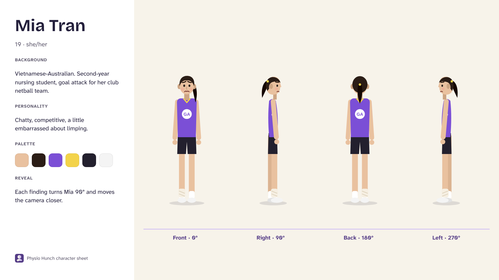
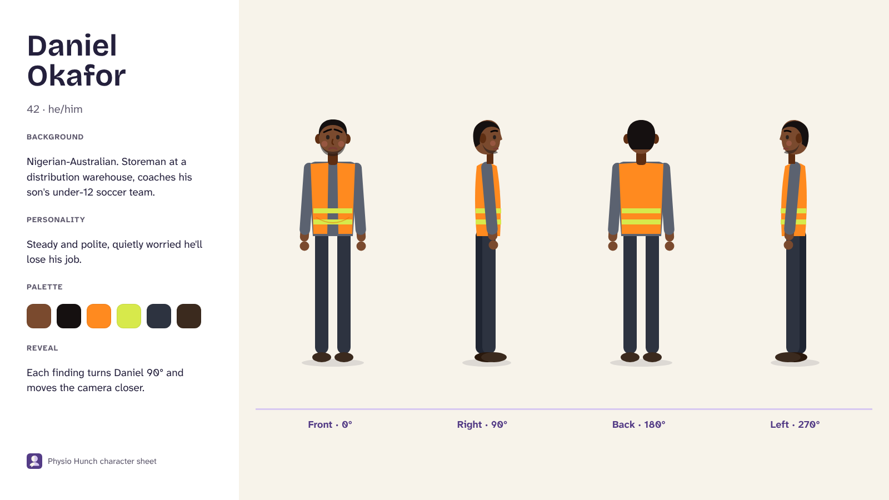
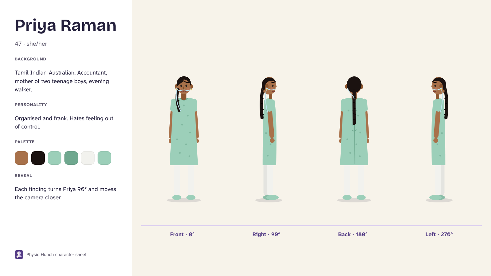
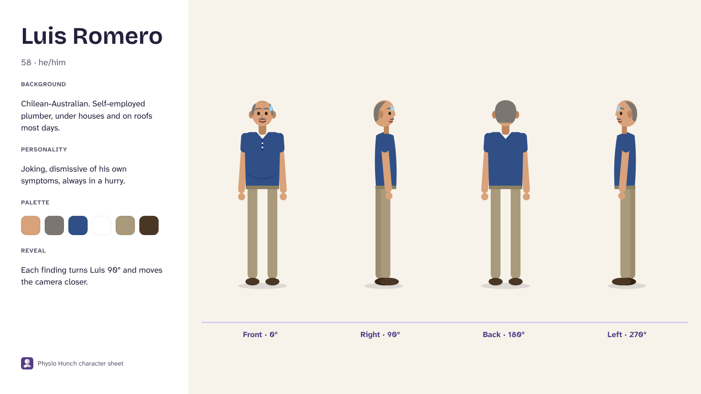
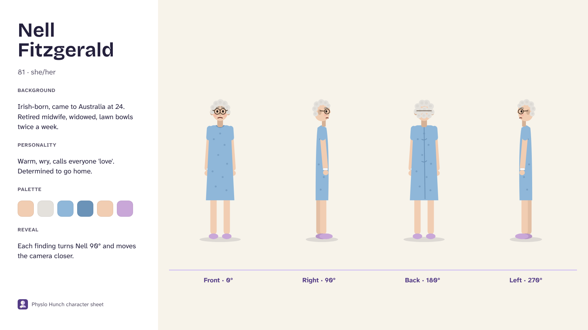

Five assessments, one diagnosis. You meet one patient and you're given only the situation. Every assessment you type uses one of five slots. A relevant one reveals a finding, turns the patient 90° and moves the camera closer. An irrelevant one gets silence. Then you make your call.

## The iOS app

The app is native SwiftUI for iOS 26 and uses Liquid Glass (`glassEffect`, `GlassEffectContainer` and the `.glassProminent` button style) for the controls. The patient and findings sit on the brand's cream and paper surfaces.

Open `ios/PhysioHunch.xcodeproj` in Xcode 26, choose an iPhone simulator and run. The project uses folder-synced groups, so any file you add under `ios/PhysioHunch/` is included automatically. CI (`.github/workflows/ios.yml`) runs the engine tests and a simulator build on every push that touches `ios/`.

## How it plays without AI

Everything is deterministic code.

1. The **resolver** (`Engine/Resolver.swift`) turns what you typed into one assessment from `assessments.json`. It tries an exact alias match first, then an alias found inside your sentence, then a typo-tolerant match (edit distance 1, or 2 for long words). If two assessments tie, such as "anterior drawer" for knee and ankle, it picks the one relevant to this patient. Unrecognised text doesn't use a slot.
2. The **case data** (`cases.json`) maps assessment ids to findings. Anything not listed gets silence.
3. **Mechanics** (`Engine/Mechanics.swift`) are small rules that plug into the turn pipeline: `prepare`, `veto`, `shape`, `after` and `judge`. The standard set:
   - The five-assessment limit
   - No repeats (free to reread)
   - Safety flags from each case's rules, such as standing Nell up before checking her obs
   - The diagnosis verdict (correct, close or wrong)
   - Scoring
4. Typing `I think...` or tapping **Make your call** lets you diagnose early.

### Adding things

- To add an assessment, put an entry in `ios/PhysioHunch/Resources/Data/assessments.json` with an id, a name, a category and aliases. Aliases of three letters or fewer match whole words. Longer ones match word stems.
- To add a case, put an entry in `cases.json` with its findings keyed by assessment id, plus answers, close answers, key assessments, safety rules, a focus point and a turnaround name.
- To add a mechanic, write a struct conforming to `Mechanic`, implement only the hooks you need, and add it to `Mechanics.standard`.
- To add a character, add a spec to `characters/characters.json` and re-export the turnaround images and sheet.

## Characters

See the [pixel-art concept sheet and turn-and-zoom notes](docs/characters.md) for the original web case roster. The table below shows the native app’s roster and its current turnaround assets.

| | Patient | Case |
| --- | --- | --- |
|  | Mia Tran, 19, Vietnamese-Australian netballer | Lateral ankle sprain |
|  | Daniel Okafor, 42, Nigerian-Australian storeman | S1 radiculopathy |
|  | Priya Raman, 47, Tamil Indian-Australian accountant | Post-operative atelectasis |
|  | Luis Romero, 58, Chilean-Australian plumber | Cardiac pain referred to the shoulder |
|  | Nell Fitzgerald, 81, Irish-born retired midwife | Right MCA stroke |

`characters/turnaround.js` is one parametric vector rig drawn front, right, back and left. The app expects image sets named `Patient-<id>-front`, `-right`, `-back` and `-left`, so hand-drawn turnaround art can replace any of them without code changes.

## Brand

See the [brand guide](docs/brand.md). The app ships static instances of Bricolage Grotesque 650 and Atkinson Hyperlegible Next 400/700, renamed and bundled with their SIL OFL licences in `ios/PhysioHunch/Resources/Fonts`.

## Web prototype

The original browser version (exam and practical modes) is still at the repository root in `index.html`. It uses the earlier case set.

The cases are for study practice and aren't official University of Newcastle material. See `research/viva-research.md` for sources.
