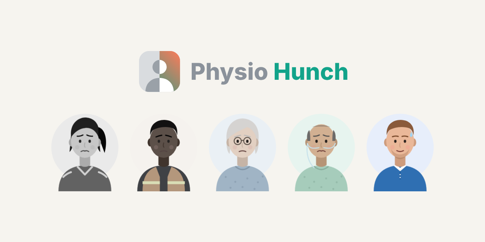

Five assessments, one diagnosis. You meet one patient and you're given only the situation. Every assessment you type uses one of five slots. A relevant one reveals a finding, turns the patient 90° and moves the camera closer. An irrelevant one gets silence. Then you make your call.

## The iOS app

The app is native SwiftUI for iOS 26 and uses Liquid Glass (`glassEffect`, `GlassEffectContainer` and the `.glassProminent` button style) for the controls. The patient and findings sit on the brand's cream and paper surfaces.

Open `ios/PhysioHunch.xcodeproj` in Xcode 26, choose an iPhone simulator and run. The project uses folder-synced groups, so any file you add under `ios/PhysioHunch/` is included automatically. CI (`.github/workflows/ios.yml`) runs the engine tests and a simulator build on every push that touches `ios/`.

## How it plays without AI

Everything is deterministic code.

1. The **resolver** (`Engine/Resolver.swift`) turns what you typed into one assessment from `assessments.json`. It tries an exact alias match first, then an alias found inside your sentence, then a typo-tolerant match (edit distance 1, or 2 for long words). If two assessments tie, such as "anterior drawer" for knee and ankle, it picks the one relevant to this patient. Unrecognised text doesn't use a slot.
2. The **case data** (`cases.json`) maps assessment ids to findings. Anything not listed gets silence.
3. **Mechanics** (`Engine/Mechanics.swift`) are small rules that plug into the turn pipeline: `prepare`, `veto`, `shape`, `after` and `judge`. The standard set:
   - The five-assessment limit
   - No repeats (free to reread)
   - Safety flags from each case's rules, such as standing Nell up before checking her obs
   - The diagnosis verdict (correct, close or wrong)
   - Scoring
4. Typing `I think...` or tapping **Make your call** lets you diagnose early.

### Adding things

- To add an assessment, put an entry in `ios/PhysioHunch/Resources/Data/assessments.json` with an id, a name, a category and aliases. Aliases of three letters or fewer match whole words. Longer ones match word stems.
- To add a case, put an entry in `cases.json` with its findings keyed by assessment id, plus answers, close answers, key assessments, safety rules and a turnaround name.
- To add a mechanic, write a struct conforming to `Mechanic`, implement only the hooks you need, and add it to `Mechanics.standard`.
- To add a character, add a row to the turnaround sheet, extend the row and column lists in `tools/cut_turnarounds.py`, and re-run it.

## Case file opening

The [interactive folder demo](demo/case-file.html) shows the yellow cover, clipped patient portrait, case notes and pass reveal. See the [case file handoff](docs/case-file.md) for the reusable art layers and bindings.

## 100-patient expansion

The [expansion roster](demo/expansion-roster.html) previews 100 case briefs, portraits and 16-angle turning sheets. See the [case and asset handoff](docs/expansion.md) for practice areas, source data and app integration.

## Daily cases

Every day the website draws five random patients from the whole bank: the five authored cases plus the 100 expansion briefs in `cases/expansion/cases.psv`. The draw survives a refresh and changes the next day. See [docs/expansion.md](docs/expansion.md#how-the-website-plays-the-briefs) for how briefs play before they get full findings.

## Characters

The patients come from the [turnaround sheet](assets/characters/patient-turnarounds.png). See [docs/characters.md](docs/characters.md) for the style and the turn-and-zoom rules.

The [individual turn GIFs](assets/characters/turn-clips) include eight one-shot clips per patient, animated from [16 pixel poses each](assets/characters/pose-atlases). Use the [manifest](assets/characters/turn-clips/manifest.json) to find clips from the current view, or see [the playback guide](docs/characters.md#individual-turn-clips) for a five-turn example.

| Patient | Age | Case |
| --- | ---: | --- |
| Mia Tran | 19 | Lateral ankle sprain |
| Daniel Okafor | 42 | S1 radiculopathy |
| Margaret Collins | 68 | Right MCA stroke |
| Robert Nguyen | 71 | Post-operative atelectasis |
| Gary Whitfield | 58 | Cardiac pain referred to the shoulder |

The app draws patients from the 16-pose atlases in `assets/characters/pose-atlases` (sliced into `Pose-<case>-00` to `-15` in the asset catalogue). Each new finding plays a quarter turn through four poses while the camera eases to that view's framing. Sides push in to 1.31× centred on the face, the back pulls out to 0.84×, and the front resets. `tools/cut_turnarounds.py` cuts the original sheet into 20 sprites (`assets/characters/sprites/<case>-<view>.png`). It removes the background, labels and neighbouring slivers, and puts each patient's four views on one shared anchor. The app loads them as `Patient-<case>-front`, `-right`, `-back` and `-left`, drawn with nearest-neighbour scaling so the pixels stay crisp. Each new finding advances one view (front, right, back, left), and the zoom steps independently through 1.0×, 1.05× and 1.10× to a cap of 1.15×.

## Previews

`demo/physio-hunch-iphone15.html` is a playable browser preview of the app inside an iPhone 15 frame. CI also records the real app on an iPhone 15 simulator and uploads the screenshots and video as the `iphone15-demo` artifact on each run.

## Brand

See the [brand guide](docs/brand.md). The app ships static instances of Bricolage Grotesque 650 and Atkinson Hyperlegible Next 400/700, renamed and bundled with their SIL OFL licences in `ios/PhysioHunch/Resources/Fonts`.

## Website (GitHub Pages)

`index.html` is the public site: the logo top-left, Buy Me a Coffee top-right, the game in the middle, and searchable content underneath (how it works, the cases, what vivas test, FAQ). On desktop the patient sits beside the consultation. On phones it becomes a one-screen app layout. It reads the same case data as the iOS app (`ios/PhysioHunch/Resources/Data`) and draws patients from the pose atlases. `site/game.js` holds the web engine and `site/site.css` the styles. SEO lives in the page title, description, Open Graph tags, JSON-LD (WebApplication and FAQPage), `robots.txt` and `sitemap.xml`.

To publish: go to Settings, then Pages, choose Deploy from a branch, and pick this branch with `/ (root)`. The site goes live at `https://sophiang-builds.github.io/Physio-hunch/`. Set your Buy Me a Coffee link in `index.html` (search for `YOUR-HANDLE`).

## Web prototype

The original browser version (exam and practical modes) now lives in `classic/`. It uses the earlier case set.

The cases are for study practice and aren't official University of Newcastle material. See `research/viva-research.md` for sources.
